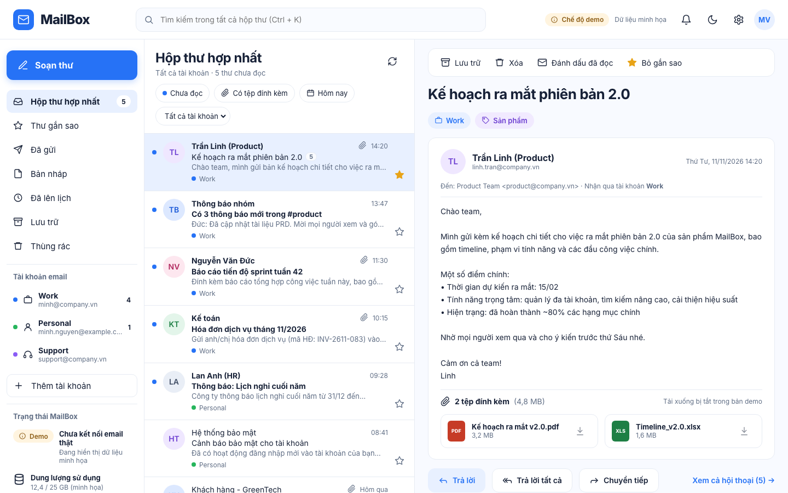
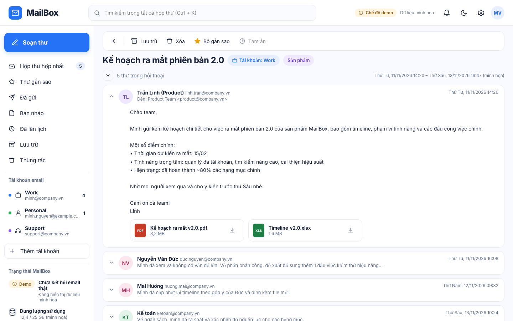
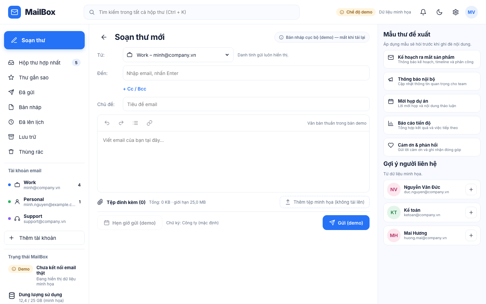
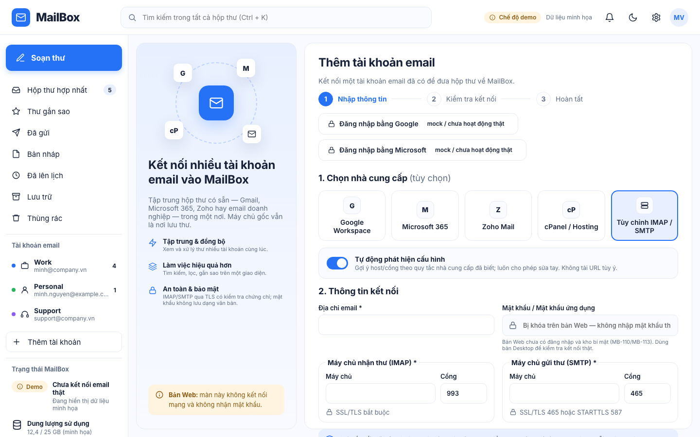
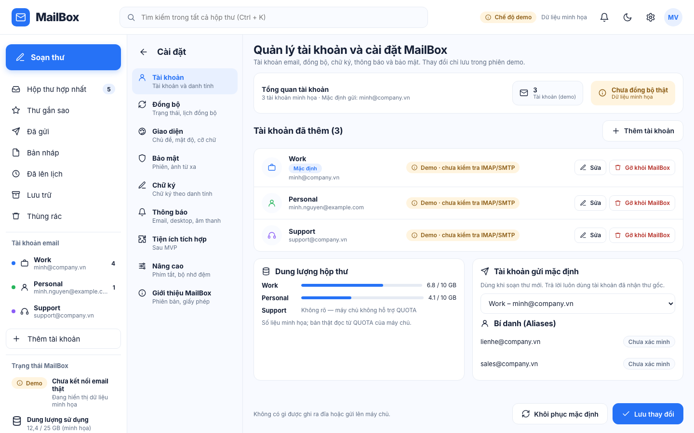
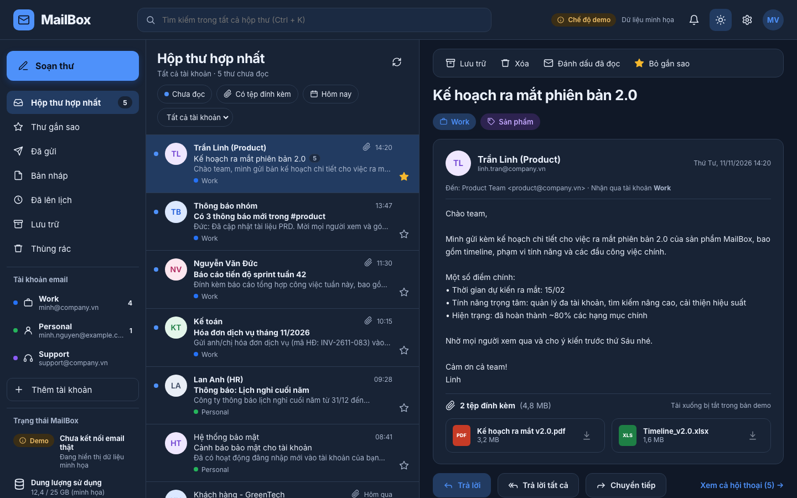

# MailBox

**Beautiful, simple, self-hosted email — written in Rust for Web and Desktop.**

> **Status: v1.0.0, Desktop first (2026-11-15).** The Desktop app is a working IMAP/SMTP client in "Real mode" and still ships a clearly labelled demo mode with fixture mail. The macOS build is made locally and is unsigned. **There is no Windows installer yet** (the GitHub Actions build has not passed), Linux is untested, and the Web build is a demo without sign-in. Open work and known limits: [`docs/06-delivery/SESSION_HANDOFF_2026-11-15.md`](docs/06-delivery/SESSION_HANDOFF_2026-11-15.md), [`docs/06-delivery/LIMITATIONS_1.0.md`](docs/06-delivery/LIMITATIONS_1.0.md), [`docs/04-security/AUDIT_1.0.md`](docs/04-security/AUDIT_1.0.md).

## Screenshots

All screenshots show **demo mode** with fixture mail (no real account), taken from the Web build at 1440×900. The Desktop app uses the same interface.

| Unified inbox | Conversation |
|---|---|
|  |  |

| Compose | Connect an account |
|---|---|
|  |  |

| Settings | Dark theme |
|---|---|
|  |  |

## What problem does it solve?

Many bought/hosted business email accounts work technically but come with a poor webmail interface. MailBox aims to provide a clean, Gmail-like experience for **existing** accounts: aggregate them into a unified inbox without becoming an email hosting provider. IMAP/JMAP read; SMTP submits outgoing mail. Original mail servers remain the source of truth.

## Architectural choices

- **All-Rust UI**: Dioxus 0.7.x. A shared UI codebase targets `wasm32-unknown-unknown` on Web and native Rust + system WebView on Desktop.
- **Desktop**: the app talks to the mail servers itself (IMAP, SMTP), keeps metadata and cached bodies in a local SQLite file and passwords in the OS keychain. Nothing is sent to a MailBox server.
- **Backend**: Axum for authenticated Web APIs when implemented. The included demo Axum server only serves static fixture JSON, has no authentication and binds to `127.0.0.1` by default. Do not expose it.
- **Core**: platform-independent Rust domain contracts and ports, with connector crates behind them.
- **Storage**: SQLite on Desktop (in use); PostgreSQL for hosted Web deployments (same queries, not deployed).
- **Sync**: Tokio workers, IMAP IDLE or polling, UIDVALIDITY per folder, safe retries. Runs only while the app is open.
- **Security**: TLS with validated certificates and no bypass, SSRF guard for autoconfig, sanitized HTML in a sandboxed frame, remote content blocked until asked, links confirmed before opening.

## Repository map

```text
mailbox/
├── AGENTS.md                    # Rules and workflow for all agents
├── CLAUDE.md                    # Claude Code entrypoint
├── apps/
│   ├── mailbox-ui/             # Dioxus Web + Desktop app (components, screens, state, adapters)
│   └── mailbox-api/            # Axum read-only demo endpoints (localhost only, no auth)
├── crates/
│   ├── mailbox-contracts/      # Serde DTOs and the demo fixture dataset
│   ├── mailbox-core/           # Domain types, ports, sync policy, link inspection
│   ├── mailbox-net/            # TLS connections with certificate validation
│   ├── mailbox-imap/           # IMAP client: login, sync, bodies, flags, IDLE
│   ├── mailbox-smtp/           # SMTP submission
│   ├── mailbox-mime/           # MIME parsing, HTML sanitizer, safe file names
│   ├── mailbox-compose/        # Building outgoing messages
│   ├── mailbox-store/          # SQLite / PostgreSQL store behind the core ports
│   ├── mailbox-secrets/        # OS keychain secret store
│   └── mailbox-autoconfig/     # Provider detection (table, SRV, autoconfig XML)
├── migrations/
│   ├── sqlite/                 # Applied by the Desktop app at start
│   └── postgres/               # For Web deployments; not run in 1.0
├── e2e/                         # Playwright Web E2E (test tooling only)
├── docs/
│   ├── 00-product/             # Vision, personas, scope, PRD
│   ├── 01-features/            # Feature specs + acceptance criteria
│   ├── 02-architecture/        # System design, sync, data, API, ADRs
│   ├── 03-ui/                  # UI design system, flows, references
│   ├── 04-security/            # Threat model, privacy, 1.0 audit
│   ├── 05-engineering/         # Standards, dependencies, tests
│   └── 06-delivery/            # Roadmap, tracking, limitations, session handoffs
└── .github/workflows/          # Windows release build, started by hand for a version tag
```

## Quick start: prerequisites

- Rust through `rustup`. The version is pinned in `rust-toolchain.toml` (1.100.0) with `rustfmt`, `clippy` and the `wasm32-unknown-unknown` target; `rustup` installs it on first use.
- Dioxus CLI `dx` compatible with Dioxus 0.7. Desktop requires OS WebView dependencies (Linux WebKitGTK, macOS system WebView, Windows WebView2).
- Reference docs: https://dioxuslabs.com/learn/0.7/ and https://docs.rs/axum/.

```sh
rustup target add wasm32-unknown-unknown
cargo install dioxus-cli --version 0.7.10 --locked

# Ensure rustup's cargo wins over a system (Homebrew) cargo
export PATH="$HOME/.cargo/bin:$PATH"

# Run browser UI (fixture mode). `-p mailbox-ui` is required with dx 0.7.10.
cd apps/mailbox-ui
dx serve -p mailbox-ui --web

# Run desktop UI (same source; native binary)
dx serve -p mailbox-ui --desktop

# Real Web E2E (Playwright, test-only tooling; starts dx serve itself)
cd ../../e2e && pnpm install && pnpm exec playwright test --workers=1

# Separately run local demo JSON API
cd ../..
cargo run -p mailbox-api
curl http://127.0.0.1:3000/healthz
curl http://127.0.0.1:3000/api/v1/demo/bootstrap

# Tests/static checks (requires Rust toolchain)
cargo fmt --all -- --check
cargo test --workspace --exclude mailbox-ui
cargo check -p mailbox-ui --no-default-features --features web --target wasm32-unknown-unknown
# Optional on macOS/Windows/Linux with WebView dependencies:
cargo check -p mailbox-ui --no-default-features --features desktop
```

**Data path (MB-103):** the Desktop app reads fixtures through `mailbox-core` in-process and needs nothing else running. The Web build reads them from the demo API, so start `cargo run -p mailbox-api` (127.0.0.1:3000) before `dx serve --web`; without it the Web UI shows an error with a retry button.

## What works in 1.0 (Desktop, Real mode)

- Connect an IMAP/SMTP account with provider autoconfig; passwords go to the OS keychain.
- Folder roles and multi-folder sync, live sync (IDLE or polling) with reconnect.
- Read messages: MIME, sanitized HTML in a sandboxed frame, remote images blocked until asked, attachments saved on request.
- Star, read, archive, trash and move reach the server, with undo.
- Compose, reply and forward with attachments; real sending with sent / failed / unknown states and a copy in Sent; local drafts; scheduled send while the app is open.
- Local search, "load older", conversations, templates, signatures, keyboard shortcuts, new-mail notifications.
- Links in a message never open by themselves: a click shows the real address and asks first.
- Vietnamese (default) and English interface.
- Demo mode with fixture mail, labelled as demo; it never sends anything.

### What does *not* work or is not verified

- **Windows**: no installer yet; the GitHub Actions build has not passed. **Linux**: not built or tested.
- **macOS**: unsigned local build (Gatekeeper warns); notification banners for the unsigned build not confirmed.
- **Web**: demo only. No sign-in, no credential vault, no hosted deployment.
- OAuth sign-in (Gmail, Outlook) is a labelled mock; use an app password.
- No sync or scheduled send while the app is closed; no server-side search; drafts are not synced to the server's Drafts folder; no mobile layout.
- The local database is not encrypted at rest.
- Two Medium audit findings are open (S-10 Windows attachment marking, S-11 a SQLite advisory through sqlx).

The full list, with what each item needs to become real, is in `docs/06-delivery/LIMITATIONS_1.0.md`.

## Where to continue

Read **`AGENTS.md`**, **`CLAUDE.md`**, then **`docs/06-delivery/SESSION_HANDOFF_2026-11-15.md`** (current state, open work, questions for the owner) and **`docs/06-delivery/TRACKING.md`**.

## Reference UI designs

Located under `docs/03-ui/references/`:

1. Unified inbox
2. Connect account
3. Thread/conversation
4. Compose
5. Account & settings

These are the **approved visual direction**; they are generated mockups, not proof that the product functionality exists. Match components and behaviors, not fabricated dates/provider status.

## Open source

Licensed under **Apache-2.0** (see `LICENSE`). Third-party dependencies remain governed by their own licenses; see `docs/05-engineering/DEPENDENCIES.md`.

- Security reports: see [`SECURITY.md`](SECURITY.md). Please do not open a public issue for a vulnerability.
- Contributing: see [`CONTRIBUTING.md`](CONTRIBUTING.md).
- Builds: macOS and Linux are built locally. The only GitHub Actions workflow builds the Windows release and runs only when someone starts it by hand for a version tag.
