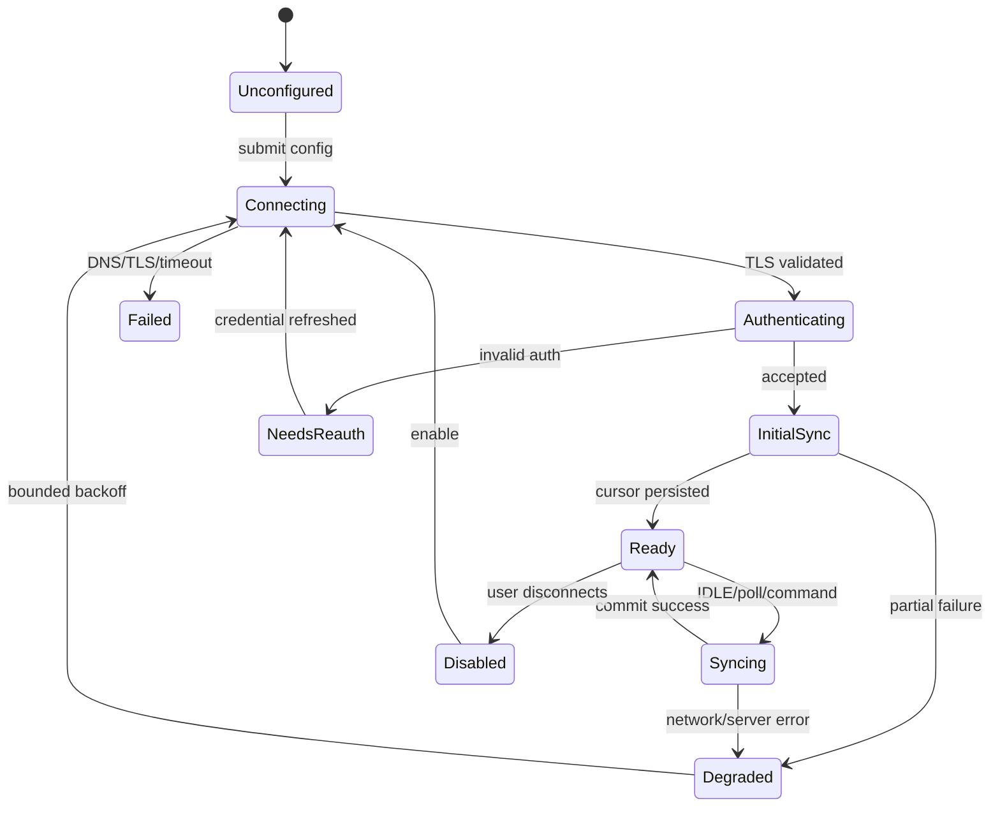
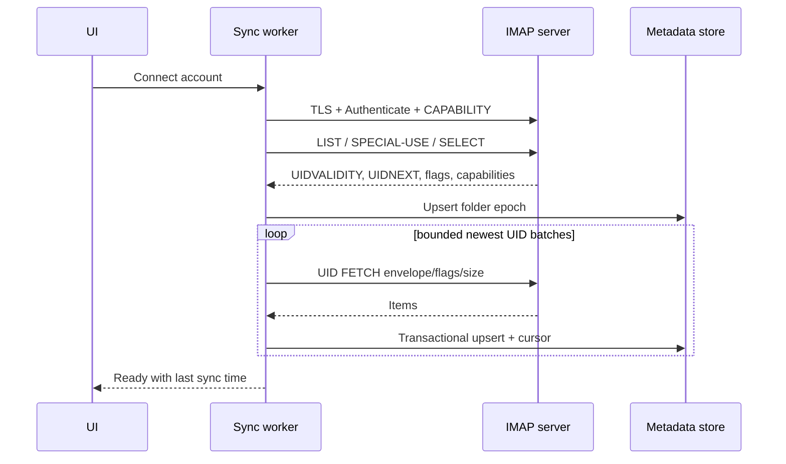
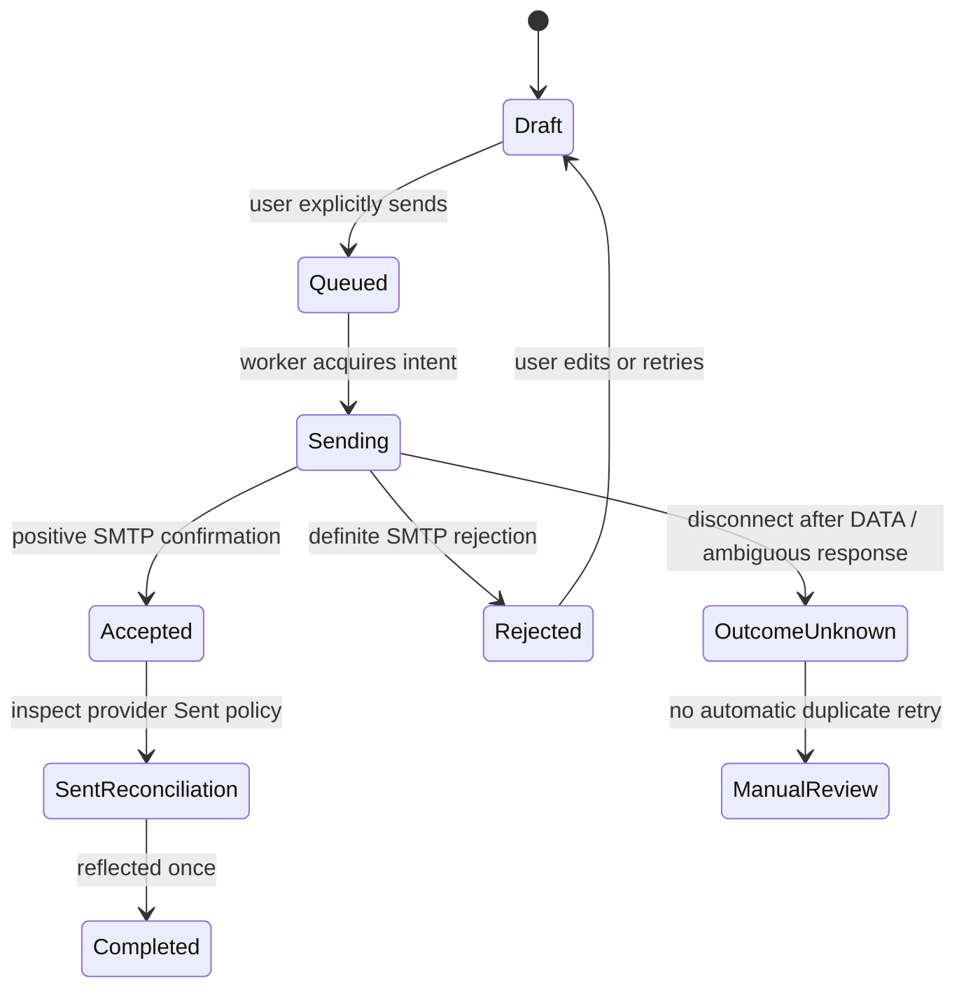

# IMAP/SMTP technical design: sync, conflict, recovery

**This is the implementation specification, not implemented functionality.** Agents must read before writing protocol code. IMAP extensions are capability-gated. Do not assume server supports CONDSTORE/QRESYNC/IDLE/UIDPLUS/MOVE/SPECIAL-USE/QUOTA.

## 1. Account connection state machine

UI states: `not_configured`, `testing`, `connecting`, `authenticating`, `syncing`, `connected`, `degraded`, `reauth_required`, `disabled`, `offline_cache`. **Never claim connected until authenticated and initial sync has actually succeeded.**

## 2. Folder identity, UID and UIDVALIDITY

**Canonical key**: `(owner_id, account_id, folder_id, uidvalidity, uid)`.

- UID is meaningful only within one folder and one UIDVALIDITY epoch.
- On changed UIDVALIDITY: invalidate UID-mapped cache for affected folder, preserve safe drafts, rebuild cursor and show reconciling state.
- `INTERNALDATE` and `Message-ID` are not unique primary keys; Message-ID may be missing or duplicated.
- Folder rename requires mapping policy; do not use display folder name as immutable global ID.
- After expunge/move, remove/tombstone cache as appropriate; never reuse vanished UID blindly.

## 3. Initial sync sequence

Initial fetch reads metadata first; message bodies are lazy. Respect per-provider pages, limits and body size ceilings.

## 4. Incremental sync

1. Reuse account-level session pool within limits.
2. If IDLE supported, wait for change notifications; otherwise poll with adaptive intervals.
3. SELECT folder and verify UIDVALIDITY.
4. Prefer QRESYNC/CONDSTORE when advertised; otherwise use UID-based reconciliation and periodic flag scan.
5. Apply mutations in DB transaction; cursor update and rows commit atomically.
6. Publish diff event; browser/desktop UI renders fresh state. Reconnect after backoff+jitter.

**No retry storms:** cap global/protocol connections, per-account retries, and provider-specific rate limits. Never reconnect every UI rerender or browser tab.

## 5. Flag mutation protocol

Use UID STORE (not sequence numbers for cached messages). Show `pending` state until remote acknowledgement; if failure, revert or show a visible conflict. For `\\Seen`/`\\Flagged`, merge server truth. Preserve non-standard flags if provider supports them and avoid accidentally erasing unknown flags.

## 6. Sent-mail state machine

Deduplication cannot be guaranteed solely by `Message-ID`. The SMTP submission protocol does not offer generic exactly-once semantics. Record intent ID, immutable MIME hash, attempts, provider response summary, timestamps and status. Mask sensitive error content.

## 7. Message content and attachments

- Parse MIME recursively with configurable depth and size limits; support multipart/alternative and attachments.
- Headers: encoded words, address lists, charset, HTML/plain fallback, large embedded objects.
- HTML is sanitized and rendered in isolated/no-privilege context; remote content disabled by default.
- Attachment binary should be streamed or bounded; safe filenames; content-type verified; no auto-execution.
- Desktop: never render arbitrary HTML in a WebView context that exposes privileged Rust IPC.

## 8. SMTP TLS and auth

- IMAP implicit TLS commonly port 993. SMTP implicit TLS often 465; SMTP STARTTLS often 587. Port numbers are defaults, not proof of security.
- Cert verification and hostname checks required. STARTTLS must not downgrade or fall back to cleartext.
- Auth types negotiated according to provider capabilities. OAuth2 and app passwords handled as different credential types.
- Enforce explicit sender identity against configured account/allowed aliases; no silent cross-account switching.

## 9. Provider compatibility test matrix

| Provider test fixture | IMAP login | SMTP | Special-Use | IDLE | Reconnect | Flags | Sent-copy policy |
|---|---|---|---|---|---|---|---|
| cPanel/Dovecot | ☐ | ☐ | ☐ | ☐ | ☐ | ☐ | ☐ |
| Generic hosting/Exim | ☐ | ☐ | ☐ | ☐ | ☐ | ☐ | ☐ |
| Zoho | ☐ | ☐ | ☐ | ☐ | ☐ | ☐ | ☐ |
| Gmail (OAuth flow) | ☐ | ☐ | ☐ | ☐ | ☐ | ☐ | ☐ |
| Microsoft 365 (OAuth flow) | ☐ | ☐ | ☐ | ☐ | ☐ | ☐ | ☐ |
| Local test IMAP server | ☐ | ☐ | ☐ | ☐ | ☐ | ☐ | ☐ |

## 10. Fault injection scenarios

- TLS certificate expired or wrong hostname.
- Credential revoked; app password required; OAuth refresh fails.
- DNS changes between validation and connection (DNS rebinding/SSRF).
- UIDVALIDITY changes while application offline.
- Message deleted by second client while preview open.
- IMAP server sends malformed MIME, huge folder count, or throttles.
- Network drops before/during/after SMTP DATA; never silently duplicate.
- Database transaction fails mid-batch; restart must avoid partial cursor progress.

## 11. RFC reading

IMAP4rev1 RFC 3501 (historic baseline), IMAP4rev2 RFC 9051, QRESYNC RFC 7162, IMAP IDLE RFC 2177, SMTP RFC 5321, SMTP Submission RFC 6409, MIME RFC 2045/2046, message format RFC 5322. Verify current standards and actual server capability before implementation.
