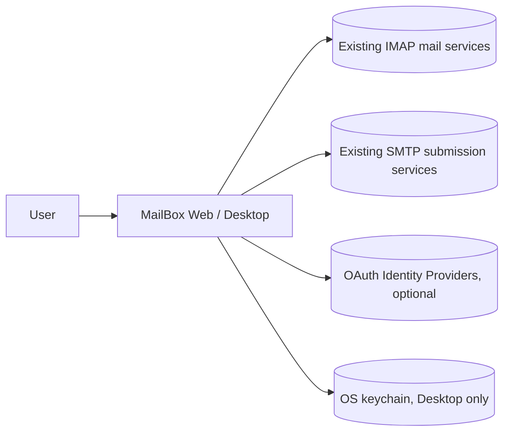
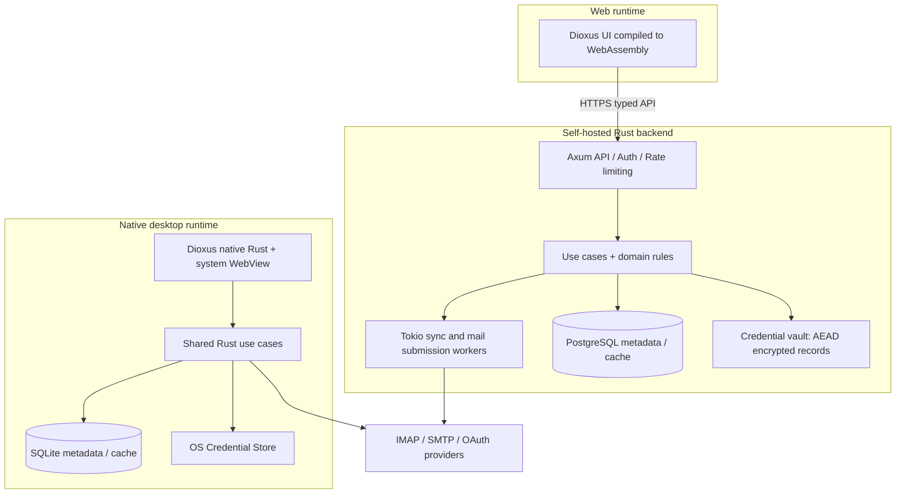

# System Design — MailBox (Rust Web + Desktop)

Status: Proposed target architecture, not current implementation. The present source has Dioxus demo screens + local Axum read-only demo endpoint, no working mail integrations.

## 1. C4-style Context



**Out of scope:** MailBox does not receive email as an MX server; its users buy mailboxes separately.

## 2. Logical containers



**Shared code**: `mailbox-contracts` and `mailbox-core`. Production implementations not yet created: `mailbox-imap`, `mailbox-smtp`, `mailbox-storage-sqlite`, `mailbox-storage-postgres`, `mailbox-security`, `mailbox-sync` (future workspace crates as needed).

## 3. Runtime differences

| Concern | Web | Desktop |
|---|---|---|
| UI rendering | Dioxus WASM in browser | Dioxus native Rust in system WebView |
| Provider network access | Only backend service; browsers do not speak IMAP | Native process; never expose arbitrary loopback HTTP listener by default |
| Authentication | Login + HTTPS sessions | OS-user boundary; optional local app unlock and OS keychain |
| Secrets | Encrypted service-side, master key separate | OS keychain / credential manager |
| Metadata | PostgreSQL | SQLite |
| Background sync | Tokio server worker, job queue (optional at scale) | Tokio native tasks when app runs; OS background policy later |
| Notifications | In-app + optional browser permission | OS notifications via supported native APIs |
| Offline state | Browser cache optional | Local metadata cache, no raw message bodies by default |

## 4. Layering

```text
UI (Dioxus)
  -> MailboxApplication (use cases: list, read, compose, connect, sync, send)
       -> Port traits (Accounts, MessageStore, SyncState, SecretStore, MailReader, MailSender)
            -> Web: adapters (PostgreSQL, encrypted vault, IMAP/SMTP)
            -> Desktop: adapters (SQLite, OS keychain, IMAP/SMTP)
```

The initial `mailbox-core` only defines two sample ports and one IMAP cursor policy. Each production slice adds precise ports without turning UI components into service locators.

## 5. DDD/bounded contexts

- **Identity**: user/session/device authorization, aliases and sender identity.
- **Accounts**: providers, endpoints, auth method, status; never couple account model to plaintext secret.
- **Mail**: folders, message metadata, body variants, attachments, flags and conversation projections.
- **Sync**: cursor, capabilities, mailbox epochs, retry/reconciliation, provider limits.
- **Composer**: local drafts, send intent, MIME construction, SMTP outcome, Sent reconciliation.
- **Preferences**: theme, navigation, notification, privacy and cache retention.

## 6. Data flow — read

1. UI requests paginated messages and current sync state.
2. Use case authorizes user/account; reads metadata cache.
3. Worker reconciles IMAP folders according to protocol capabilities.
4. Message selection fetches MIME body via bounded path; sanitizes HTML before rendering.
5. UI renders sender, account badge and synchronization freshness.

## 7. Data flow — send

1. UI drafts email and selects **explicit From account**.
2. Backend/native use case validates recipient fields, sender authorization, attachments, size and policy.
3. MIME builder streams/bounds payload; store send-intent ID and durable state.
4. Native SMTP worker submits over authenticated/validated TLS.
5. `accepted` only on protocol confirmation; connection loss after DATA => `outcome_unknown`, no blind retry.
6. Sent-folder policy: provider auto-copy or controlled IMAP APPEND, avoid duplicates.

## 8. Scalability and performance assumptions

- Target initial deployment: 1–10 accounts/user; one self-hosted instance; tens of thousands of messages/account supported via **pagination and bounded cache**.
- Cap concurrent IMAP connections by account/provider and globally. Avoid opening one IDLE connection per browser tab.
- Sync metadata first, full bodies on demand; max-size MIME/attachment guardrails.
- Search v0.1 uses account/folder scoped server search + cached metadata; v0.2 can enable encrypted/local content index by opt-in.
- Database indexes on owner/account/folder/UID and received date; never store one UID as global primary key.

## 9. Consistency model

- Provider server remains authoritative for messages/folders/flags.
- UI may optimistically render a flag change but tracks `pending` and rolls back if remote write fails.
- A failed sync cannot show "Đồng bộ hoàn tất". Last successful time and partial account failures remain visible.
- Delete account is local detach/purge unless user explicitly requests server-side actions.

## 10. Observability

Collect only aggregate metrics: per-account sync attempt duration, socket errors by category, queue depth, retry count, cache size, time since successful sync. No sender addresses, subjects, bodies, attachments or secrets in metrics, logs or traces by default.

## 11. Environment configuration

Development `MAILBOX_BIND=127.0.0.1:3000`, `RUST_LOG=info`. Production **must** add auth, HTTPS, reverse proxy, db and secret vault before any non-loopback bind. The demo API **must not be public**.

## 12. Decision links

- `adr/0001-rust-platform.md`
- `adr/0002-provider-source-of-truth.md`
- `adr/0003-storage-split.md`
- `adr/0004-api-boundaries.md`
