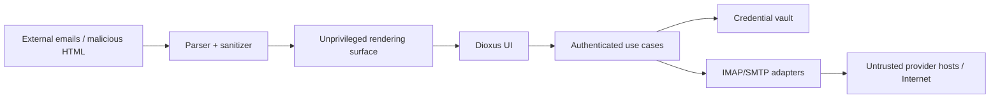

# Threat model — mailbox credentials, untrusted email and network egress

**Status: Required gates, NOT implemented in starter.** This is a high-impact application because it handles credentials and sensitive communications. Aesthetic UI cannot substitute for security proof.

## Assets

1. IMAP/SMTP app passwords, OAuth tokens and provider configuration.
2. Mailbox contents (body, subject, sender/recipient, attachments).
3. Draft content, sending identity, outgoing mail intent.
4. User sessions, desktop OS integration, attachments saved to filesystem.
5. Multi-account/tenant authorization boundaries.

## Trust boundaries

## Threat register

| ID | Threat | Impact | Mitigation and test evidence |
|---|---|---|---|
| T01 | Stored XSS/HTML active content in received email | Critical | Parse/sanitize; isolate preview without Desktop native bridge; CSP; malicious corpus tests |
| T02 | SSRF via custom server host/ports/autodiscovery | Critical | Allowlist ports, block private/link-local/metadata egress on hosted Web; resolve and recheck DNS, protect redirects/proxies; integration tests |
| T03 | IMAP/SMTP credential leakage in logs/DB | Critical | OS keychain Desktop; AEAD vault Web, separate master key; redacted tracing and response serialization tests |
| T04 | Broken cross-user/account auth | Critical | Every resource scoped by authenticated principal; negative ownership tests; rate limits |
| T05 | TLS downgrade / invalid certificate | High | Require correct TLS/STARTTLS + certificate and hostname validation; cert fault injection |
| T06 | Path traversal in attachment filenames | High | Ignore paths in provided filename; safe storage name & isolation; Unicode/path tests |
| T07 | Duplicate SMTP send after timeout | High | `outcome_unknown`, no blind retry; explicit intent state machine and fault injection |
| T08 | Blind external image tracking | Medium | Block remote images by default; per-message opt-in |
| T09 | Malicious MIME decompression/recursion | High | Max MIME depth/part count/body size; bounded streaming; fuzz tests |
| T10 | CSRF/session fixation (Web) | High | HttpOnly/Secure/SameSite cookies, anti-CSRF tokens, session rotation/logout tests |
| T11 | Desktop WebView native IPC exposed to email HTML | Critical | Separate read-only/sandboxed preview from privileged webview; deny bridge in untrusted content |
| T12 | Dependency supply chain | High | Lockfile, cargo audit, licenses review, minimum permissions |
| T13 | Malicious/incorrect local mailbox cache | Medium | DB migrations, integrity checks, cache rebuildability; cryptographic storage where needed |
| T14 | Unsupported OAuth scopes | Medium | PKCE, minimal scopes, revoke on disconnect, expiry handling |
| T15 | DoS via connection storms or huge mailboxes | High | Global/per-provider connection pools, pagination, backoff, message/attachment caps |

## Explicit security gates before connecting real users

1. **Identity/auth**: authenticated Web sessions, account ownership authorization, CSRF and request limits.
2. **Secrets**: no plaintext secret storage or logs; OS keychain/AEAD + key rotation doc.
3. **Network**: verified TLS; SSRF-safe host discovery/connect policy; no dangerous redirects.
4. **Content**: MIME parser with fuzz/size guards; HTML sanitization and isolation; remote content disabled.
5. **Sending**: sender identity enforcement and unambiguous user-visible submission state.
6. **Testing**: integration tests and security regression suite; documented independent review before v1.0.

## Hosted Web vs self-hosted local deployment

Even a single-user service on a VPS is Internet-exposed when proxied publicly. SMTP/IMAP credentials and email content demand authentication, secure session design and transport protection. Demo server currently **binds localhost only** and is not designed for a public reverse proxy.

## Reporting incidents

Report suspected credential leakage, account takeover, wrong-recipient send or unauthorized remote resource loads as release blockers. Rotate/revoke affected credentials, remove logs containing sensitive data, assess scope and publish appropriate security advisories; do not hide incidents behind a normal bug label.
