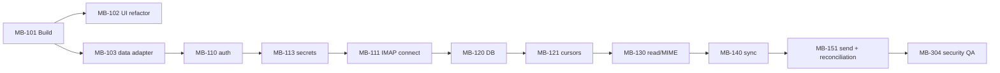

# Execution roadmap — MailBox Rust

Guiding rule: first make the **shared Web + Desktop shell real and verifiable**; then build a secure real-account vertical slice; only then optimize/expand.

## Phase 0 — Foundation / current starter

Scope: repository + docs, Dioxus 5 screen demo, shared DTOs, no real provider. **Status: authored, not compiler-verified**.

- MB-001 directory structure (authored)
- MB-002 docs/features/UI reference set (authored)
- MB-101 compile/run Dioxus Web and Desktop, resolve toolchain (not started)
- MB-102 extract reusable UI components, proper mobile navigation and visual QA (not started)
- MB-103 create typed cross-platform data adapter and connect UI to API fixtures (not started)

**Exit gate**: both platform builds execute, five routes work, no real secret accepted, UI tests and screenshot QA recorded.

## Phase 1 — Secure accounts and local storage

- MB-110 session/auth boundaries (Web) and native permission model
- MB-111 IMAP account connect with verified TLS
- MB-112 SMTP capability test and sender policy
- MB-113 secret store (desktop keychain, web AEAD vault)
- MB-120 SQLite/PostgreSQL repository + migrations
- MB-121 sync cursor + folder discovery with safe ownership checks

**Exit gate**: first real read-only inbox from a test provider; no plaintext secrets, no public demo endpoint.

## Phase 2 — Mail core MVP

- MB-130 messages/folder pagination, body fetch/MIME parser
- MB-131 safe HTML rendering and attachment handling
- MB-132 read/star/flags sync and local cache consistency
- MB-140 worker reconnect/IDLE/polling, UIDVALIDITY rebuild
- MB-150 compose/draft persistence and sender identity
- MB-151 SMTP send state machine, unknown outcomes, Sent reconciliation

**Exit gate**: 3 independent provider accounts, accurate cross-client flags and safe sending. Release initial MVP after integration/security QA.

## Phase 3 — Gmail-quality experience

- MB-200 robust unified inbox and advanced search
- MB-201 threading
- MB-202 provider autodiscovery
- MB-203 OAuth providers
- MB-210 templates, signatures, keyboard shortcuts
- MB-211 desktop notifications and mobile responsive completion
- MB-218 scheduled sending (not initial MVP)

**Exit gate**: measured usability, a11y, localization and performance.

## Phase 4 — v1.0 Production

- MB-300 web auth hardening & SSRF defense review
- MB-301 backup/restore and operating guide
- MB-302 signed desktop installers, updates
- MB-303 CI cross-platform, Dovecot SMTP test matrix
- MB-304 security audit, perf/fuzz/stress
- MB-305 v1.0 documentation, tagged release

**Exit gate**: no known critical security issues and reproducible release for Web/macOS/Windows/Linux.

## Dependency critical path

Note that SMTP connection test MB-112 and safe composer MB-150 must also precede MB-151. Architectural risk reviews can be parallel, but never skip prerequisite security gates.
